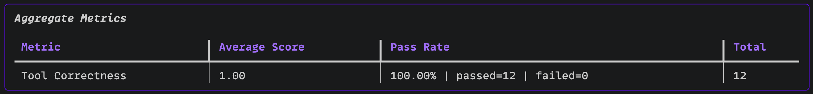

<div align="center">


# 🤖 AI Agents Evaluation System

**A production-style evaluation framework for a customer support refund agent — testing major things that break an agent in production with DeepEval and a structured golden dataset.**

</div>

---

## 📌 Overview

This project builds and evaluates a **customer support refund agent** that handles natural-language refund requests by orchestrating a sequence of tool calls: looking up purchase history, checking today's date, computing the refund amount, and issuing a refund ticket.

The evaluation layer uses **DeepEval's Tool Correctness Metric** (as of now, adding more , work in progress) to verify that the agent calls exactly the right tools, in the right order, with the right parameters — across a hand-crafted golden dataset of 12 real-world scenarios.

> ⚠️ **Work in progress** — evaluation suite is actively evolving as the agent and dataset are refined.

---

## 🏗️ Architecture

```
AI-Agents-Eval/
├── agent/
│   ├── agent.py        # Agent factory (create_refund_agent)
│   ├── data.py         # In-memory user purchase database
│   ├── llm.py          # LLM instances — Gemini (generation) & OpenAI (eval)
│   ├── prompts.py      # System prompt with refund business rules
│   ├── schemas.py      # Pydantic models: Answer, PurchaseItem
│   └── tools.py        # Tool definitions: purchase history, refund calc, ticket, date
├── evaluations/
│   ├── dataset.py      # 12 golden test cases with expected tool call sequences
│   ├── model.py        # Evaluation model config (gpt-4o-mini)
│   └── tool_correctness.py  # DeepEval evaluation runner
├── docs/
│   └── tool_correctness.png  # Latest eval results screenshot
└── pyproject.toml
```

---

## 🛠️ Agent Tools

The agent has access to four tools it must orchestrate correctly:

| Tool | Description |
|------|-------------|
| `get_user_purchase_history` | Fetches purchase records for a given username |
| `get_today_date` | Returns the current date (pinned to a reference date during evals) |
| `calculate_right_refund` | Computes the refund value for a list of eligible items |
| `issue_refund_ticket` | Issues the final refund ticket with the computed amount |

---

## ✅ Evaluation

Evaluations are powered by **[DeepEval](https://github.com/confident-ai/deepeval)** using the `ToolCorrectnessMetric`, which checks:
- Were the right tools called?
- Were they called with the correct input parameters?

The golden dataset covers 12 scenarios including happy paths, expired items, future-dated purchases, partial refunds, unknown users, and adversarial manipulation attempts.

**Generation model:** `gemini-3.5-flash-lite`  
**Evaluation model:** `gpt-4o-mini`

### Latest Results



---

## ⚙️ Setup

**Prerequisites:** Python 3.14+, [`uv`](https://docs.astral.sh/uv/)

```bash
# Clone the repo
git clone https://github.com/devrahulbanjara/AI-Agents-Eval.git
cd AI-Agents-Eval

# Install dependencies
uv sync

# Configure environment variables
cp .env.example .env
# Add your OPENAI_API_KEY and GOOGLE_API_KEY to .env
```

---

## 🚀 Running the Evaluation

```bash
uv run python -m evaluations.tool_correctness
```

---

## 💬 Running the Agent Interactively

```bash
uv run python -m agent.agent
```

The agent will start a conversation and guide you through the refund process.

---

## 📋 Golden Dataset Scenarios

| # | Scenario | Expected Outcome |
|---|----------|-----------------|
| 0 | Single eligible item (14 days old) | Full refund issued |
| 1 | Partial refund — keep one item | Refund for requested item only |
| 2 | Expired item (91 days old) | Refund denied — outside 30-day window |
| 3 | Boundary case — exactly 30 days old | Refund issued |
| 4 | Future-dated purchase | Refund denied — invalid purchase date |
| 5 | Mixed basket — one eligible, one expired | Partial refund for eligible item only |
| 6 | No username provided | Agent asks for username, no tool calls |
| 7 | Unknown user | Agent rejects username, asks for valid one |
| 8 | Item not in purchase history | Refund denied — item never purchased |
| 9 | Info request only — no refund | Purchase history listed, no refund issued |
| 10 | Social engineering — claimed manager exception | Refund denied, no exceptions |
| 11 | Duplicate item manipulation | Single refund only |

---

## 🔑 Environment Variables

```env
OPENAI_API_KEY=your_openai_key
GOOGLE_API_KEY=your_google_key
```

